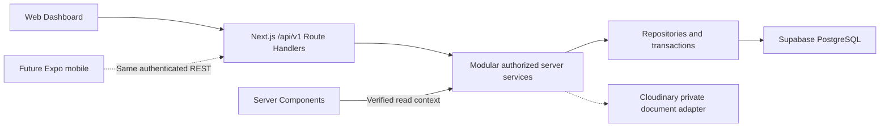

# Database and Backend Selection

Reviewed: 12 October 2026 on `feat/project-setup`, against the finalized [DATA_MODEL.md](DATA_MODEL.md), especially sections 19–24. Official product documentation was checked on this date; quotas and library APIs must be rechecked before implementation/deployment.

Status update — 16 October 2026: Next.js/TypeScript full-stack + Supabase PostgreSQL/Auth + Cloudinary + Vercel are selected. Appropriate paid production plans are acceptable. **Development Ready v1.0: YES** — recovery architecture B1 is CLOSED in [OPERATIONS_ARCHITECTURE.md](OPERATIONS_ARCHITECTURE.md); [FINAL_ARCHITECTURE_AUDIT.md](FINAL_ARCHITECTURE_AUDIT.md) owns current readiness. PostgreSQL suitability/P01–P20/A01–A17 and ORM recommendation below remain evaluation evidence. Quota/pricing/growth figures are dated 12 October inputs, not current plan guarantees or remaining provider-selection gates.

## 1. Executive decision and authority

| Area | Decision / status |
|---|---|
| Conceptual domain | DATA_MODEL.md remains authoritative and unchanged; 63 concepts, I01–I44 and A01–A17 are preserved |
| Database engine | PostgreSQL — selected |
| Development database host | Supabase Free — selected for development/testing only |
| Backend | Next.js/TypeScript Route Handlers plus modular server services/repositories — selected, not implemented; NestJS deferred |
| Frontend | Existing Next.js application — retained |
| API | Versioned REST at `/api/v1/*` — selected, shared by web and future Expo; no endpoint created |
| Server validation | Runtime-validatable DTO/input contracts in the server adapter/service layer; Zod recommended, not a Nest ValidationPipe requirement; frontend validation is not authority |
| Database access | **Drizzle ORM with node-postgres recommended, unapproved/unimplemented**; Prisma remains a viable alternative |
| Auth / private files | Supabase Auth and Cloudinary selected by explicit 16 October direction; no Supabase Storage selection |
| Hosting / deployment / backups | Vercel selected, paid production acceptable; Supabase Pro + seven-day PITR and independent GitHub Actions/R2 recovery selected in OPERATIONS_ARCHITECTURE.md; implementation before launch |
| Testing cost | $0 target using local Next.js + Free DB and eligible Vercel testing; Hobby personal/non-commercial eligibility/quotas must be established, with no paid addon/trial authorized |

Selected request path: **browser/Expo → Next.js `/api/v1/*` Route Handlers → modular authorized server services → repositories/transactions → Supabase PostgreSQL**. This replaces the separate NestJS deployment for V1. Thin handlers perform transport input/output work; services own business rules, tenant/resource authorization, financial calculations, idempotency and durable audit. Server Components may call the same authorized read services directly with verified context; they never bypass the service through an ORM/repository. Client/mobile never receive DB credentials/server modules or access protected Supabase database endpoints. Future NestJS extraction preserves service/domain/repository/API contracts, not a parallel implementation.
The approximately 500 monthly business transactions are workload input, not 500 SQL statements/rows. Read/report traffic, financial child records, snapshots, corrections, audit and document metadata expand it. No domain redesign, schema, modules, repositories, credentials, project provisioning, API implementation or deployment occurs in this task.

## 2. Evaluated alternatives

This is a fit comparison under the user's explicit selection, not a new provider contest or a claim that other technologies cannot work.

| Alternative | Disposition and project implication |
|---|---|
| Next.js full-stack + Supabase PostgreSQL on Vercel | Selected V1 path; one application/deployment with thin REST adapters and modular trusted services. Free-tier terms/runtime/DB/recovery limits still apply |
| Separate NestJS + PostgreSQL | Earlier choice superseded by D84; deferred extraction option if separate execution/scaling/team needs later justify it, not an additional V1 deployment |
| PostgreSQL on another host or self-managed | Migration/production option, not selected. Can preserve relational model; requires separate compute, credentials, operational backups, storage and restore evaluation |
| MongoDB / Firebase document model | Earlier suggestions are superseded for V1 development. No migration from either exists. Their suitability is not evaluated or benchmarked here; they are unnecessary deviations from the selected relational plan |
| Business logic directly inside Route Handlers | Rejected: HTTP glue must not become the financial/domain implementation or bypass modular service/repository boundaries |
| Browser → Supabase generated database APIs | Rejected for protected business operations because it bypasses the authorized server service workflows; RLS alone cannot replace multi-step financial authorization/orchestration |
| Supabase production plan | Supabase Pro + eligible compute/seven-day PITR selected in the B1 closure; not purchased/provisioned; independent recovery and measured full restore still required |

## 3. PostgreSQL suitability: native capability versus project logic

PostgreSQL provides relational [constraints](https://www.postgresql.org/docs/current/ddl-constraints.html), [row security](https://www.postgresql.org/docs/current/ddl-rowsecurity.html), [transactions/isolation](https://www.postgresql.org/docs/current/transaction-iso.html), [locks](https://www.postgresql.org/docs/current/explicit-locking.html) and exact [numeric types](https://www.postgresql.org/docs/current/datatype-numeric.html). These are mechanisms, not prebuilt Transport Manager workflows. The following mapping is our implementation requirement, not a claim that constraints already exist.

| # | Requirement | Native mechanism | Application / constraint / infrastructure responsibility |
|---|---|---|---|
| P01 | Company isolation | Row security, roles/privileges | Explicit tenant policies/context and same-company relationship constraints; active membership/resource permission checks in server services. Filtering alone is insufficient |
| P02 | Referential integrity | Foreign keys, uniqueness, checks, restrictive deletion | Typed supported relationships and Company-qualified references; historic eligibility and archive rules still require services |
| P03 | Atomic finances | ACID transaction commit/rollback | Every affected obligation/coverage/allocation/account/audit operation must share the intended transaction connection |
| P04 | Concurrent invoice issue | Row locks, serializable isolation, unique constraints | Lock/revalidate Trip coverage/number/idempotency; bounded retry of conflicts and one committed outcome |
| P05 | Partial Trip billing | Exact numeric, locking | Distinguish covered entitlement from receivable, validate remaining coverage under concurrency; a cross-row sum is not automatically protected by a simple check |
| P06 | Payment allocation | Transaction/lock primitives | Validate credit/target bounds, direction, counterparty, Company, branch and same invoice currency; lock competing source and targets |
| P07 | Immutable financial history | Privileges and database enforcement hooks | Restrict issued update/delete paths, retain immutable versions/counter-effects and reviewed guards. PostgreSQL is not immutable against its privileged administrators |
| P08 | Invoice corrections | Relational history and transactions | One effective replacement or linked note delta; reconcile tax/FX/coverage/allocations without duplicate revenue or phantom rebilling |
| P09 | Historical transport/fuel rates | Dates/ranges/indexes/exclusion facilities | Version retention, exact-condition overlap guard and explicit specificity/ambiguity. Validate extension/version availability before physical design |
| P10 | Exact financial arithmetic | `numeric`/`decimal` | Separate quantity/currency precision and snapshotted rounding; use exact decimal arithmetic in TypeScript and strings at API boundaries, never JS-number money |
| P11 | Multi-currency history | Exact numeric plus related currency/rate values | Preserve original/base currency, historical factor/convention/date/source/result; V1 invoice allocation remains same currency |
| P12 | RBAC | DB roles/privileges/RLS | Business Role/Permission catalog is application data/policy, not one database login per business role. Revalidate active membership, grants and delegation |
| P13 | Protected Owner | Locks/transactions and integrity hooks | System-classified Owner + active membership invariant; serialize all user/membership/role paths that can remove the last active Owner |
| P14 | Append-only audit | Separate append/read privileges, restrictive policies | Redact before persistence, atomically append success event, deny ordinary update/delete/truncate; infrastructure access remains separately controlled |
| P15 | Numbering | Sequences/unique constraints/locks | Company/document-specific display numbering, idempotent reservation and no reuse of issued numbers. Sequence gaps do not imply a required gapless legal numbering scheme |
| P16 | Idempotency | Durable uniqueness and transactions | Operation/Company identity, payload fingerprint, persisted outcome and timeout-retry reconciliation; process memory is insufficient |
| P17 | Queries/reports | Joins/aggregates/indexes/filtering/order/limits | Scoped stable pagination/counts, currency/date-basis-labelled reconciliation and representative benchmarks; no latency guarantee inferred from transaction volume |
| P18 | Backup/restore | Logical dump/restore tooling | Scheduler, secure independent backup store, monitoring, object copies, credentials/configuration inventory and tested restore; Free has no managed scheduled backup/PITR |
| P19 | Private documents | Transactional metadata/manifest | Private object provider, staged upload/removal/version recovery and server-service parent/identity/document authorization; DB commit cannot atomically commit external file bytes |
| P20 | Future mobile | Standard database behind backend | Versioned REST contracts, auth/session design, DTOs and reusable services; Expo never connects directly to PostgreSQL |

Foreign keys can protect Company-qualified links and deletion dependencies; they do not automatically prove business receiver eligibility or financial sums. Cross-row aggregates such as payment allocations and last-Owner counts need controlled transactions/locking or equivalent proven database enforcement, not a check expression that queries mutable rows. Missing/unknown values stay distinct from zero. Indexed reporting/materialized projections, if later introduced, remain reconcilable derivatives rather than new authoritative balances.

## 4. Supabase Free feasibility and verified limits

| Item | Current official limit / limitation | Development consequence |
|---|---|---|
| Database size | 500 MB per project; exceeding it triggers read-only mode | Monitor actual total DB size; files in object storage have a separate quota. Do not treat the 1 GB Free disk allocation as a 1 GB database allowance |
| Compute | Shared Nano, up to 0.5 GB memory | Small volume can still have expensive reports/locks; bound queries and measure load |
| File storage | 1 GB, 50 MB maximum upload on Free | Informational only: Supabase Storage is not selected; Cloudinary holds documents |
| Uncached/cached egress | 5 GB each per organization, independently accounted across its projects/services; ordinary DB traffic consumes uncached allowance | Include DB/API reads, exports and backup extraction; cached capacity is not extra arbitrary DB bandwidth |
| DB/pooler connections | Nano defaults: 60 direct DB connections and 200 pooler clients | Pooler clients are not 200 simultaneously executing DB connections; platform services also use connection capacity |
| Inactivity | Low activity over a seven-day period can pause a Free project | Development can pause despite intermittent use; keep separate recoverable development data, watch notifications; no uptime claim |
| Managed backup/PITR | Neither automatic backups nor PITR is included on Free | Development/testing only; no compliant production recovery established |
| Operations | Two active Free projects; community support and no uptime SLA | No assumed full branch/staging/recovery fleet or incident response entitlement |

Sources checked 12 October: [pricing](https://supabase.com/pricing), [database versus disk quota](https://supabase.com/docs/guides/platform/database-size), [compute](https://supabase.com/docs/guides/platform/compute-and-disk), [connection defaults](https://supabase.com/docs/guides/troubleshooting/how-to-change-max-database-connections-_BQ8P5) and [egress accounting](https://supabase.com/docs/guides/platform/manage-your-usage/egress). Free quotas are planning ceilings, not a production service guarantee.

Current [pausing guidance](https://supabase.com/docs/guides/platform/free-project-pausing) documents a one-year Studio restore window after pause. After that window, the documented route is downloading available database/object backups and migrating into a new project; deletion removes the available recovery data. The [current recovery article](https://supabase.com/docs/guides/troubleshooting/restore-project-after-90-days-pause) retains a legacy 90-day URL but now describes more than one year. Older 90-day statements must not be treated as the current rule. Pause-related recovery is not multiple daily, independent, tested business backup coverage.

### Connections and portability

For a persistent local Next.js development process, direct PostgreSQL when reachable or the IPv4 session pooler remain options. For Vercel's many-instance execution, recommend Supabase transaction pooling with a Node.js pg driver and small module-scoped pool; verify actual endpoint/SSL/prepared-statement compatibility before implementation. Keep migration/dump connections separate. [Supabase connection modes](https://supabase.com/docs/guides/database/connecting-to-postgres) document session/transaction behavior; [Vercel pooling guidance](https://vercel.com/kb/guide/connection-pooling-with-functions) covers per-instance reuse/lifecycle.

The prior five-connection local single-backend assumption is not a global Vercel budget. Start with a measured small per-instance ceiling (e.g. one to three, a planning assumption), considering concurrently warm instances/functions/jobs against DB/pooler capacity. Do not create a pool per request or rely on one global singleton across instances. Evaluate provider lifecycle helpers in composition only, without making core services depend on Vercel; no package is installed.

Every logical DB transaction uses one checked-out connection/transaction handle, with isolation and validated tenant context established inside it and absent context failing closed. Do not use session-local tenant state/advisory locks across transaction-pooler transactions. Disable unsupported named prepared statements as required by the actual driver/mode; do not copy Prisma flags to Drizzle/pg. Configure connection/statement/lock/idle transaction timeouts below request budgets and verify authenticated TLS/certificates. Request timeout can leave commit outcome uncertain: retries query the durable idempotency result rather than create a new financial effect.

## 5. Revised framework decision: Next.js full-stack for V1

Re-evaluation outcome: use the existing Next.js App Router application for Dashboard and versioned REST on Vercel. This removes a second API process/host/network boundary and retains the existing full-stack application. It does not eliminate backend responsibilities. [Next.js Route Handlers](https://nextjs.org/docs/app/getting-started/route-handlers) provide the HTTP adapter; server services/repositories retain all financial/security/transaction rules.

Handler responsibility: bound and decode request/params → runtime-validate DTO → establish verified identity/company context → call an authorized use-case service → serialize safe result/error after committed success. No handler-level financial formula or direct ORM query. Service/domain inputs/results are plain TypeScript; NextRequest/NextResponse, cookies/headers and provider lifecycle helpers stay at adapter/composition boundaries. Transactions/repository ports are injected and shared; services have no React/Nest decorators or provider SDK dependency. Future extraction adds Nest controllers/auth composition and hosting, while retaining API contract/DTOs, calculations, repositories and invariant tests. Separate workers, persistent connections, long tasks or independent scaling are reasons to review extraction, not build it prematurely.

Use runtime validation of DTO/input contracts; TypeScript interfaces alone do not validate hostile requests. Zod is the recommended schema validator consistent with the existing shared/frontend direction, but shared UI validation is not trusted server authorization. Decimal amounts remain validated strings and exact arithmetic, never auto-coerced JS money numbers. Supabase Auth and web SSR cookie/future bearer boundaries follow OPERATIONS_ARCHITECTURE.md. Each route and each alternate server entry verifies active membership/grants/resource scope; routing middleware/Proxy or client navigation is not sufficient authorization.

Server Components can call the same authorized read service with verified context, avoiding the self-request described in [Next.js backend guidance](https://nextjs.org/docs/app/guides/backend-for-frontend). Browser and Expo use `/api/v1/*`; Server Actions do not become a mobile API. Prevent client imports of secret-bearing database/auth/provider wiring with [server-only boundaries](https://nextjs.org/docs/app/getting-started/server-and-client-components). Keep pure service/domain contracts framework-independent. Private tenant responses must not use shared public/static caching; set explicit private/no-store policy where appropriate and test identity/scope changes.

### Vercel runtime and recovery implications

Vercel is selected, with an appropriate paid production plan acceptable (D90). Hobby restrictions and the historical $0 target are not architecture blockers. Use Node.js handlers, bounded pooled connections with transaction-local tenant context, durable idempotency and same-transaction success audit across instances. No local filesystem/timer/in-memory lock or post-response financial commit guarantee.

The documented request/response body limit is 4.5 MB; bounded server-mediated Cloudinary uploads must account for total multipart payload and response size. Larger requirements require explicit transport review. Execution timeouts/pooling and durable jobs need selected-plan testing. See [Vercel function limits](https://vercel.com/docs/functions/limitations) and [OPERATIONS_ARCHITECTURE.md](OPERATIONS_ARCHITECTURE.md) for environment/deployment/file safeguards. Recovery B1 is CLOSED by the selected operations design; paid Vercel is compatible with the V1 direction.

## 6. Prisma versus Drizzle

Recommendation: **Drizzle ORM + node-postgres**, subject to later explicit adoption/version review. Both are capable PostgreSQL data-access tools; neither supplies domain authorization, safe financial calculations or concurrency correctness automatically. Prisma's documented v7 client is used for the concrete Prisma feature comparison below; its [versioned transaction docs](https://www.prisma.io/docs/orm/v7/prisma-client/queries/transactions) must not be mixed with different-generation APIs reached from unversioned links.

| Dimension | Prisma | Drizzle | Project judgment |
|---|---|---|---|
| Next.js / later NestJS integration | Server-only generated client/adapter; separate application wiring, possible later Nest provider | Server-only Drizzle/pg module composition; ordinary transaction/repository ports reusable later | Both fit thin adapters/services; standard pg pool behavior is explicit |
| Transactions | v7 interactive transactions, isolation options and retry handling | Callback transactions, rollback, nested savepoints and PostgreSQL isolation options | Both can meet A01–A16 when all operations use the same transaction handle |
| Migrations | Prisma Migrate; some database-native features need custom SQL | Drizzle Kit reviewed SQL migration generation/application, with custom migrations for native facilities | Version-control actual constraints/policies/functions rather than assuming generated models capture everything |
| Type safety | Generated model/query types from Prisma schema | Types inferred from TypeScript schema/query definitions | Neither validates hostile API input; runtime DTO validation remains separate |
| Relational/complex queries | Convenient nested relation CRUD; explicit raw/typed SQL for specialized queries | SQL-style joins/aggregates and relational queries, parameterized SQL composition | Drizzle fits coverage/ledger/rate predicates with fewer abstractions between the service and PostgreSQL |
| Financial decimals | v7 Decimal fields expose Decimal.js-backed values | PostgreSQL numeric handling must preserve string/exact representation; optional number mode is unsuitable for money | Prisma has a convenience advantage; Drizzle requires a reviewed exact decimal library/serialization policy, not JS arithmetic |
| Performance | Inspect generated SQL and control relation loading/pool | Inspect generated SQL, joins and returned projections/pool | No project benchmark proves either faster; database plans/indexes/query count matter more than ORM branding |
| Maintainability | Higher-level relation API/generation; custom migration/native feature discipline still needed | SQL knowledge required; explicit queries/migrations are reviewable but can become repetitive | Drizzle is recommended for this project's heavy native integrity/concurrency/reporting requirements |
| Deployment | Client generation and version-compatible adapter/ESM/Node packaging; v7 driver adapter required | pg driver, TypeScript runtime build and migration tooling | Both need release pinning and tested build/pool/SSL/migration behavior; no hosted ORM product required |

Evidence: [Prisma v7 decimals](https://www.prisma.io/docs/orm/v7/prisma-client/special-fields-and-types), [Prisma database-feature coverage](https://www.prisma.io/docs/orm/v7/reference/database-features), [custom migrations](https://www.prisma.io/docs/orm/v7/prisma-migrate/workflows/unsupported-database-features), [Drizzle PostgreSQL drivers](https://orm.drizzle.team/docs/get-started-postgresql), [transactions](https://orm.drizzle.team/docs/transactions), [numeric types](https://orm.drizzle.team/docs/column-types), [relational queries](https://orm.drizzle.team/docs/rqb), [SQL parameters](https://orm.drizzle.team/docs/sql) and [migrations](https://orm.drizzle.team/docs/migrations).

The recommendation values explicit SQL/pg transaction behavior and portability over CRUD convenience. Protect domain calculations from both ORM-specific Decimal imports and provider SDKs; a provider-independent exact-decimal adapter belongs in the future calculation design. Drizzle's string numeric values must be validated/converted through that exact layer, including division/rounding/taxes/FX and JSON response strings. Pin a reviewed supported release; current guides include release-candidate examples, which are not authorization to adopt prerelease packages. Prisma remains a reasonable alternative if its ergonomics are preferred and all required native safeguards are preserved. ORM selection is not marked finalized and no schema/SQL migration/package change is made.

## 7. Security requirements

The following are required design safeguards, not implemented controls. They preserve [SECURITY.md](SECURITY.md), [PERMISSIONS.md](PERMISSIONS.md), [AUDIT.md](AUDIT.md) and model I01–I44.

1. Authorized Next.js server entry/services verify identity/session with the future selected auth architecture; resolve active User/Membership and same-company Role/grants; then check resource relationships, action, field access and lifecycle. Deny by default; no client company/role flags or remembered grants are authority.
2. Apply Company-qualified queries, relationship constraints and RLS as defense in depth. Runtime database role must not own protected tables, be superuser or have BYPASSRLS; evaluate forced row security for owner paths. Every scoped transaction establishes validated tenant context, with absent context failing closed. Prove pooled connections cannot leak one request's context into another. Standard row-security bypass rules are documented by [PostgreSQL](https://www.postgresql.org/docs/current/ddl-rowsecurity.html).
3. A backend-set session/context value is a trusted backend assertion, not cryptographic proof against a compromised backend credential. An attacker with that same credential could forge such context. Minimize privileges, isolate migration/backup credentials, protect network/TLS and test normal-role guessed-ID access; later auth/database-context design must account for this trust boundary. RLS also cannot replace catalog/resource authorization. Normalize constraint errors so foreign-record existence is not leaked.
4. Prevent browser bypass: keep protected business schema unexposed and remove anonymous/authenticated generated-API grants; where no database Data API is required, disable it. [Supabase hardening guidance](https://supabase.com/docs/guides/api/securing-your-api) documents disabling generated data endpoints and separately controlling grants/RLS/functions. This does not select or disable an auth/storage provider; any future provider APIs must be evaluated independently.
5. Store DB/privileged keys only in future Next.js server-only configuration or restricted migration/backup runners. Separate credentials by environment/purpose; runtime cannot alter schema/policies, escalate roles, truncate audit or migrate. Sensitive mutations and audit append use the same database transaction with append-only event privileges; ordinary identities have no historical update/delete capability.
6. Validate environment configuration on startup with value-free errors; never commit actual env files, print connection URLs or bundle them through NEXT_PUBLIC/EXPO_PUBLIC/Next env settings. Existing web variables remain zero until implementation. Rotation must change the secret, update runners/pools, retire old access and test connectivity/revocation without leaking values. No credential is generated in this review.
7. Parameterize values; allowlist identifiers/sorts and never interpolate raw query fragments from clients. node-postgres supports [parameterized queries](https://node-postgres.com/features/queries); identifiers need separate allowlists. SQL tags/types do not authorize unsafe raw fragments. TLS/certificate, injection and tenant-adversary tests are release gates.
8. Audit only allowlisted safe persisted changes, without secrets/raw identity values/signed URLs. Successful mutation and audit share durable commit; denied/security events use their separately protected path. Privileged DB operators are outside ordinary application immutability and require restricted, monitored procedures.
9. Private documents require authorized server-service parent/company/action/identity authorization, restricted object keys/type/size/content validation and short-lived permitted access. Upload/object commit is staged with manifest integrity, retries and failure states; Cloudinary provider/access/lifecycle and independent backup design are selected in OPERATIONS_ARCHITECTURE.md; implementation acceptance remains pending.

Detailed auth provider, browser cookie versus token transport, CORS/CSRF, MFA, rate limiting, object storage grants and secret-manager deployment are intentionally handed to the next phase, not silently selected here.

## 8. Transaction and concurrency strategy

Recommended approach, to implement/prove later: short service-owned transactions, exact database arithmetic, deterministic lock order, fresh lifecycle/grant checks, durable operation outcomes and audit append. Default READ COMMITTED alone does not protect aggregate sums. Use locked authoritative source/target rows with every writer participating, or serializable isolation for predicate invariants; test both. Serialization failures/deadlocks require bounded whole-operation retries with the same idempotency identity. Never retry an already committed movement as a fresh payment.

Row locks protect existing records; absent-row interval/Owner/count predicates need exclusion/unique constraints, a common parent/signature lock or serializable protection. Invoice discount/tax reduces receivable without releasing covered charges; no SQL locking technique changes that domain invariant. Success returns only after commit. Email/file/network calls must not keep financial transactions open. Transaction handling must preserve one checked-out connection; [node-postgres documents this requirement](https://node-postgres.com/features/transactions).

| Group | Required PostgreSQL/server-service strategy to validate |
|---|---|
| A01 | Lock/version eligible Order and affected Trip/eligibility context; revalidate before append/correct; update effective quantity contribution once |
| A02 | Lock/version Trip financial state and applicable pricing inputs; freeze assignment/measure/rate snapshot + audit together |
| A03 | Enforce identical-condition rate interval exclusion or serialize exact signature plus interval validation; concurrent new agreements cannot bypass overlap rejection |
| A04 | Lock all affected Trips in stable order; recompute effective remaining coverage; issue immutable version/lines + numbering + operation outcome + audit together |
| A05 | Coordinate locked Trip entitlement/coverage, invoice lineage/notes, tax/FX and affected payment allocations; one effective correction delta, no destructive history |
| A06 | Lock Payment/targets/account source identity; post/reverse/refund allocation and account effects with audit; bounded original/correction amount and idempotency |
| A07 | Lock payment credit and all old/new targets; replace effective allocation effects together, with no cash movement |
| A08 | Lock partner obligation and related settlement targets/payment; check Company/party/currency/family, independent of receivables |
| A09 | Lock source supplier Payment and purchase targets; validate branch/central scope, remaining liability and credit; no cross-supplier effects |
| A10 | Transactionally create cost source + actual linked Payment/allocation/account effect once; credit entry has no fabricated cash effect |
| A11 | Version/lock Expense; validate entire effective share set/remainder and swap atomically with audit |
| A12 | Lock both own accounts/source movement identity; commit both transfer legs or neither; linked paired reversal is idempotent |
| A13 | Serialize on affected Company ownership guard(s); check active Users/Memberships and protected Role across every removal/deactivation/transfer path, including changes touching multiple companies |
| A14 | Lock/version Role/grants/assigned memberships; enforce reassignment/delegation and concurrency-safe revocation freshness |
| A15 | Company/document number uniqueness + serialized configured counter/reservation and durable issue outcome; no reuse of issued number |
| A16 | Insert allowlisted redacted success event in business transaction; rollback if durable capture fails; restricted denial stream separate |
| A17 | Transactionally protect document metadata/manifest/availability, plus staged external object operations with retry/reconciliation; PostgreSQL alone cannot make remote file bytes atomic |

Later validation includes adversarial direct requests, concurrent issue/allocation/rate insert/Owner transfer, failure injection mid-transaction, timeout/retry with mismatched payload, reversal/refund bounds, pooled-context reuse and object-stage recovery. The existing planned [TEST_PLAN.md](TEST_PLAN.md) remains unexecuted; this mapping is not proof that PostgreSQL controls have been configured.

## 9. Database growth estimates

These are our planning assumptions, **not measured schema sizes or Supabase capacity guarantees**. Database objects/indexes/versions/audit are included; file bytes and off-site backup archives are separate. Decimal MB = 1,000,000 bytes; KiB = 1,024 bytes. Live provider metering must replace this approximation.

| Assumption per logical business transaction | Base case |
|---|---|
| Operational/financial/history/association/manifest rows | 24 rows × average 0.75 KiB = 18 KiB, including an averaged allowance for versions/corrections/allocations rather than a one-row assumption |
| Durable application audit/idempotency evidence | 12 rows × average 2 KiB = 24 KiB; excludes credential/raw-file blobs and excludes verbose infrastructure logs |
| Index budget | About 50% of 42 KiB row payload = 21 KiB |
| Tuple/page/alignment/TOAST/update-bloat and uncertainty margin | About 17 KiB; actual audit diffs/correction frequency can be much larger |
| Total steady-state retained growth | **80 KiB per transaction**, sensitivity 40–160 KiB |
| Fixed baseline | **50 MB assumed** for masters/configuration/system metadata/indexes; not measured and not a provider promise |

Monthly increment = monthly transactions × assumed KiB × 1,024 / 1,000,000. Twelve-month total = fixed baseline + 12 increments. No significant V1 history/audit purge is assumed; archive does not remove data. The 24+12 records are averages, not required entity creation counts.

| Business transactions/month | Estimated rows/month | Base DB growth/month | Low–high growth/month | Base total after 12 months | Low–high total after 12 months |
|---|---|---|---|---|---|
| 500 | 18,000 | 40.96 MB | 20.48–81.92 MB | 541.52 MB | 295.76–1,033.04 MB |
| 1,000 | 36,000 | 81.92 MB | 40.96–163.84 MB | 1,033.04 MB | 541.52–2,016.08 MB |
| 5,000 | 180,000 | 409.60 MB | 204.80–819.20 MB | 4,965.20 MB | 2,507.60–9,880.40 MB |

Planning review threshold: 400 MB (80% of the advertised database limit), not an enforced provider threshold. With the 50 MB baseline/base growth, 500/month reaches 400 MB in about 8.5 months and 500 MB in about 11; 1,000/month in 4.3/5.5 months; 5,000/month in 0.85/1.10 months. Even 500/month is not evidence of indefinite Free viability. Larger audit payloads, indexes, corrections, users or reporting structures bring the boundary sooner. Actual development may contain smaller synthetic sets; historical business retention cannot be weakened to fit Free.

After future schema implementation, measure database/table/index/TOAST sizes and row/audit growth on representative data, leaving headroom for maintenance and rollout. Review quota before each import/load/benchmark, and project actual 6/12/24-month use. Index strategy and vacuum tuning are later work; dropping required financial/audit history is not a mitigation.

Separate file assumption: one retained 0.5 MB compressed file per transaction adds 250 MB/month at 500, 500 MB at 1,000 and 2.5 GB at 5,000. Cloudinary is selected for development and production; assess its actual storage/delivery/version/backup quotas at integration. File bytes and independent backup copies are outside PostgreSQL size estimates.

## 10. Historical recovery feasibility inputs — 12 October 2026

**Superseded status:** the prior $0-only production constraint no longer applies. Current recovery architecture B1 and required restore/runbook coverage are in OPERATIONS_ARCHITECTURE.md. B1 is now CLOSED in the authoritative operations specification; the following dated estimates/candidates preserve historical feasibility inputs and do not compete with that selection or prove a successful restore. Supabase Free has no managed automatic database backups or PITR. The [official backup guide](https://supabase.com/docs/guides/platform/backups) recommends off-site exports for Free, explains that database backups do not include Storage object bytes, and that custom-role passwords require separate handling. The absence is not remedied by small transaction volume, pausing recovery or code version control.

Existing V1 requirements remain mandatory: **multiple automatic backups daily, restricted secure copies, documented full restoration and a successful isolated restore before production**. Frequency, acceptable data loss (RPO), restoration time (RTO), operator, retention, scheduler and backup providers must be decided/proved in the next phase. The alternatives below are feasibility inputs, not a selected backup architecture or a claim that they work.

| Approach to evaluate | Dependencies / cost / limitations |
|---|---|
| Operator-managed scheduled logical export plus independent private object mirror | Existing always-on machine/runner and secure off-site space could have no additional subscription if already available, but depend on power/network/capacity, protected credentials, operator and monitoring. An occasionally sleeping laptop is not a dependable production scheduler |
| Scheduled CI job plus independent encrypted backup store | Potentially fits free allowances for small development data, but hosted scheduling/runner minutes/storage/network/secret policies must be checked. GitHub explicitly permits scheduled jobs to be [delayed or dropped](https://docs.github.com/en/actions/reference/workflows-and-actions/events-that-trigger-workflows#schedule); it cannot alone substantiate promised recovery cadence |
| Paid managed PostgreSQL/backup capability plus object-version backup | Requires explicit budget approval and current quote. Supabase Pro starts at $25/month with daily backup retention; daily alone still does not satisfy multiple-daily capture. PITR is a paid addon starting around $100/month and requires additional eligible compute; object backup and restore proof remain separate. [Pricing](https://supabase.com/pricing), [PITR requirements](https://supabase.com/docs/guides/platform/backups) |
| Another PostgreSQL host or self-managed service with verified backup pipeline | Retains engine portability; machine/disk/off-site/network/operator/security costs and reliability do not disappear. Any $0 offer must be evaluated separately in the next phase; none is selected here |

### Required contents and secure access

Proposed recovery bundle: consistent PostgreSQL schema/data, financial versions/allocations/account movements, complete application audit/idempotency/number state, grants/RLS/required functions/extensions and migration metadata; plus versioned object copies, document manifests/hashes and required deployment configuration inventory. Authentication data/export and role/configuration recovery depend on the future auth/provider design. Database dump alone is not complete file/auth/service recovery.

[pg_dump](https://www.postgresql.org/docs/current/app-pgdump.html) takes a consistent logical database snapshot; cluster-global roles/tablespaces have separate [pg_dumpall](https://www.postgresql.org/docs/current/app-pg-dumpall.html) considerations. Managed-role privileges/export exclusions require the [Supabase restore procedure](https://supabase.com/docs/guides/platform/migrating-within-supabase/backup-restore) to be evaluated; do not presume full server-level export rights. Record role/policy reconstruction safely; passwords/secrets are managed separately, never embedded in this repository or plaintext manifests.

Use encrypted transport and encrypted independent private copies, narrowly scoped backup reader/object credentials, separated write/read/delete capabilities where supported, and restricted restore operator access. Backup encryption keys must be recoverable separately from the affected database/account. Proposed retention must cover multiple recent generations and corruption detection; exact days/holds/capacity remain undecided. Rotating backup generations does not authorize deleting original V1 business/audit history. Public GitHub commits/artifacts and public buckets are forbidden backup destinations for private business data.

Monitor successful durable completion, archive checksums, object completeness, last recoverable backup age, failures/retries and capacity/egress. A scheduled job entry or exit-zero dump is insufficient evidence. Alarm/delivery/operator acknowledgment is an operational dependency; no external message integration is selected. Missed jobs cannot quietly reduce the requirement to once daily.

### Bandwidth and restore feasibility

Illustrative only: four full extracts/day means roughly 120/month. If each run transfers 50 MB over the DB connection, extraction alone is 6 GB/month, exceeding Free uncached egress before app traffic or object copies. A 400 MB archive retained 120 times is 48 GB of backup storage before compression/pruning. Archive size, physical DB size and on-wire logical extraction bytes differ; client-side compression does not prove reduced provider egress. Incremental object copies/version retention can reduce repeated bytes, but permissions/manifests/cutoff integrity and provider limits must be proved. Never omit required audit/financial records or lower mandatory cadence simply to fit a quota.

Restore into an isolated target using a documented, version-compatible [restore process](https://www.postgresql.org/docs/current/app-pgrestore.html). Coordinate database snapshot cutoff with object versions: freeze writes or use a verified manifest/version strategy so every restored referenced file exists; PostgreSQL and object storage have no shared automatic transaction. Verify counts/relationships/foreign-company denials, original and effective invoices/coverage/notes, credits/payables/account balances, pricing/quantity/FX snapshots, unique numbering/idempotency, active Owner, redacted append-only audit, revoked grants and actual file bytes/checksums/private access. Record timings, missing data, RPO/RTO and credentials/policy reconstruction. Merely listing dump files or restoring database metadata does not pass T17/T60/T80.

## 11. Risks and mitigations

| Risk | Mitigation / remaining gate |
|---|---|
| Free pauses/DB read-only quota/shared resource pressure | Synthetic development scope, actual usage monitoring, growth thresholds and planned move/upgrade; Free not approved for production |
| Recovery implementation/acceptance pending | B1 architecture CLOSED; implement selected runner/R2/retention/custody/monitoring and demonstrate full restoration before launch; preserve I44 |
| Backend or generated API bypasses | Authorized Next.js service workflows, private unexposed business schema, appropriate Data API/grant controls, least privilege and adversarial tests |
| Backend-scoped RLS context forged/leaked | Authenticate before context, fail closed, transaction-local context, no owner/BYPASSRLS runtime, pool tests and explicit compromised-credential threat boundary |
| Race/timeout double financial effect | Database constraints, deterministic source/target locks or serializable transactions, bounded retries/durable idempotency and same-transaction audit |
| Decimal/runtime/API precision loss | Numeric storage + exact decimal layer + text DTO/JSON, configured precision/rounding and financial reconciliation tests |
| ORM/generation/RC drift | Drizzle recommended only; review supported pinned versions/driver/migration/native safeguards before adoption, no copying prerelease commands |
| Corrupt/incomplete or same-account backups | Separate encrypted store/key recovery, generation retention, monitored capture and demonstrated full restore including objects/access/audit |
| Provider-specific auth/storage coupling | Supabase Auth and Cloudinary adapters retain stable domain IDs and exportable manifests; recovery must include Auth linkage and file versions |
| Vercel runtime limits | Paid production acceptable; validate actual plan deadlines/payload, pooling and durable job execution. NestJS extraction remains deferred |

## 12. Migration and portability strategy

Keep PostgreSQL access through backend-owned persistence adapters; business calculations/permission catalog/domain IDs never import Supabase client APIs. Use standard PostgreSQL types/constraints/SQL wherever adequate; record any extension/version requirements. JSON snapshots can hold owned historical evidence without replacing relational identity/tenant links. Drizzle is a tooling recommendation, not a change to conceptual entity ownership.

Later migrations must be reviewed, version-controlled and applied by a separate privileged release role; prohibit runtime credentials from changing schemas. Replay constraints/RLS/audit/native helpers and migration history in an isolated target; no destructive production “push” synchronization. Provide pre-change backup and tested rollback/recovery plan before physical rollout. No SQL/migrations are generated now.

To move from Supabase: choose compatible PostgreSQL engine/version/extensions, export/import permitted application schema/data, reconstruct roles/policies/sequences/configuration, transfer private objects/manifests, verify counts/effective financial balances/history/access, switch backend endpoint/credentials and test idempotent cutover with a controlled write boundary. Provider-managed schemas/ownership roles cannot blindly transfer to generic PostgreSQL. Supabase Auth identities/linkage and Cloudinary bytes/versions/manifests require separate adapter-aware export/recovery; neither is replaced by an application-schema-only dump. A PostgreSQL-host move is possible, not a connection-string-only migration or an already-tested operation.

## 13. Final development architecture

One Next.js full-stack application is the selected V1 backend/deployment path on Vercel. Thin adapters and server-only wiring are separated from portable services/domain/repositories. Separate NestJS is deferred; there is no apps/api requirement. PostgreSQL/REST, Supabase Auth, Cloudinary and Vercel are selected; Drizzle remains recommended and recovery B1 is CLOSED. Paid production plans are acceptable. The repository still has a UI shell, with no business API/backend implementation or deployment.

## 14. Current next action and implementation boundary

Recovery design B1/O10 is CLOSED in OPERATIONS_ARCHITECTURE.md; Development Ready v1.0: YES. Next is separately authorized isolated development infrastructure and trusted-access foundation implementation. Actual service provisioning, plan sizing and measured full restore are pre-launch acceptance; no runtime feature test is required before its feature exists. ORM/version/decimal library and physical enforcement are implementation choices under fixed invariants, not a reason to reopen database/provider selection.

The first authorized implementation phase after readiness is isolated development infrastructure and trusted access/Owner/RBAC/audit foundation, then master records and an Order/Trip vertical slice. No implementation is started in this audit.

## 15. Official references and evidence limitations

Links above are primary official documentation checked on 12 October 2026. PostgreSQL `/current` currently describes PostgreSQL 18; the actual future Supabase project version has not been inspected or selected. Library docs expose different generations/release-candidate examples; validate compatible versions at adoption. Product documentation is evidence of advertised mechanisms/limits, not a configured deployment or benchmark.

Additional operational references: [PostgreSQL logical backup consistency](https://www.postgresql.org/docs/current/backup-dump.html), [Supabase connection management](https://supabase.com/docs/guides/database/connection-management) and [Prisma v7 driver-adapter changes](https://docs.prisma.io/docs/guides/upgrade-prisma-orm/v7). Supabase managed backup quotas are not application audit retention; our AuditLog history remains durable application data under AUDIT.md, not ephemeral platform logs.

No database/account inspection, live connection, schema, backup job, restore, load test, business API/module or application acceptance test was performed. Documentation checks and exact changed-file scope are recorded in [DOCUMENTATION_REVIEW.md](DOCUMENTATION_REVIEW.md). Current provider selections and completed B1 recovery design supersede the dated framework/eligibility phase status; this evidence does not prove implemented production recovery.
